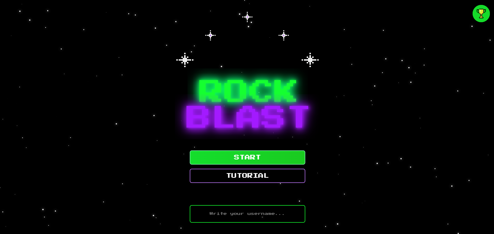
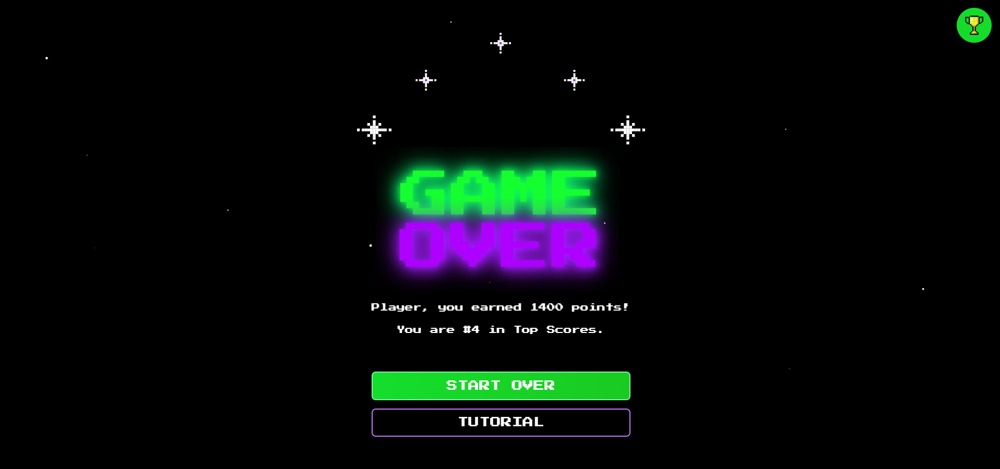
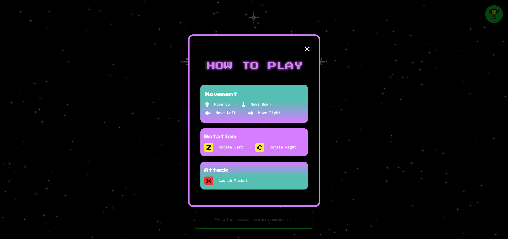
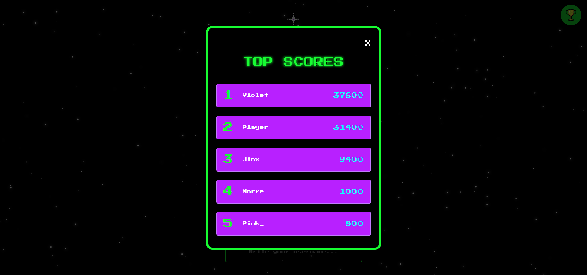
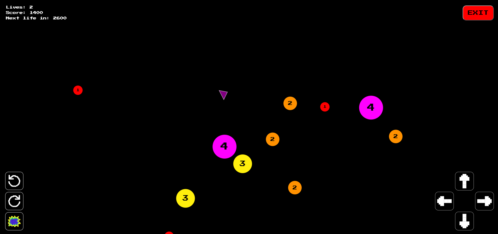

# Rock Blast

A browser arcade game with a neon pixel look. Pilot a spaceship through a field of numbered asteroids, destroy them before they hit you, and climb the leaderboard.

**[Play it here.](https://mirelalexy.github.io/rock-blast/)**



## How to play

Every asteroid shows a number: that's how many rockets it takes to destroy it. Shoot them down for points, avoid touching them, and survive as long as you can.

- Destroying an asteroid earns **200 points**.
- Colliding with an asteroid costs a life and restarts the round.
- Earn points to win extra lives (the HUD shows how far you are from the next one).
- Lose all your lives and the game ends. Your score is ranked against the top 5.

### Controls

| Action                  | Keyboard   | Touchscreen                    |
| ----------------------- | ---------- | ------------------------------ |
| Move up/down/left/right | Arrow keys | On-screen directional pad      |
| Rotate left             | Z          | Rotate left button             |
| Rotate right            | C          | Rotate right button            |
| Launch a rocket         | X          | Rocket button                  |

A built-in tutorial also explains the controls in the game.

## Features

- **Numbered asteroids:** each one's color and size reflect how many rockets it takes to destroy it, from small red ones (1) to large magenta ones (4).
- **Physics:** asteroids drift at random speeds and bounce off each other when they collide.
- **Rocket limit:** only 3 rockets can be in flight at once, so every shot counts.
- **Lives and extra lives:** a live HUD shows your lives, your score, and how far away the next extra life is.
- **Top 5 leaderboard:** scores and player names are saved in your browser with Web Storage, and the game over screen tells you where you ranked.
- **Keyboard and touch support:** playable on desktop, phone, and tablet.
- **Retro UI:** pixel font, neon glow, and an animated starfield.

## Screenshots

| Game over | Tutorial | Leaderboard |
| :---: | :---: | :---: |
|  |  |  |

| Gameplay |
| :---: |
|  |

## Run it locally

No build step needed.

```bash
git clone https://github.com/mirelalexy/rock-blast.git
cd rock-blast
```

Open `index.html` in your browser or [play it live here](https://mirelalexy.github.io/rock-blast/).

## Tech stack

- HTML, CSS, and JavaScript, no frameworks or libraries
- Web Storage API for the leaderboard

---

Hosted with GitHub pages.
